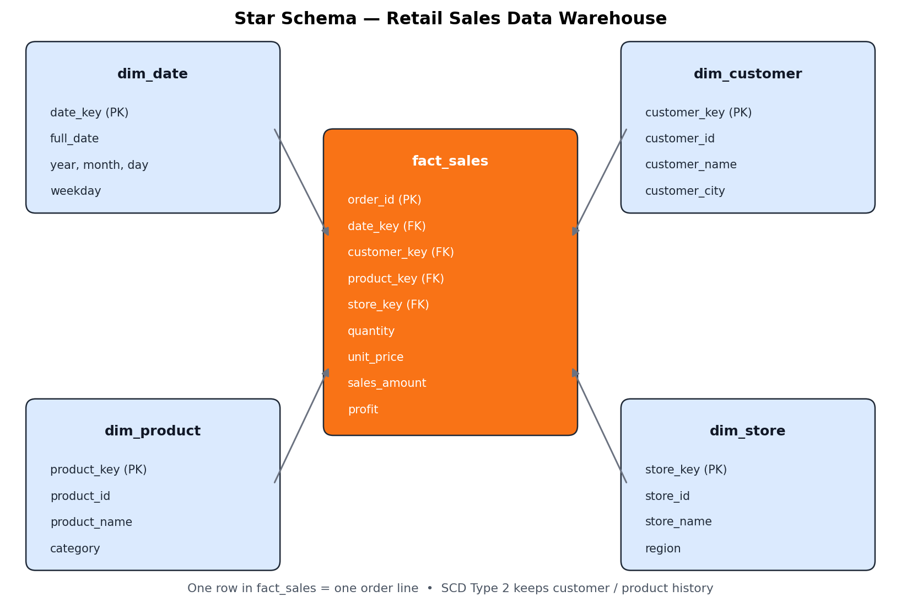
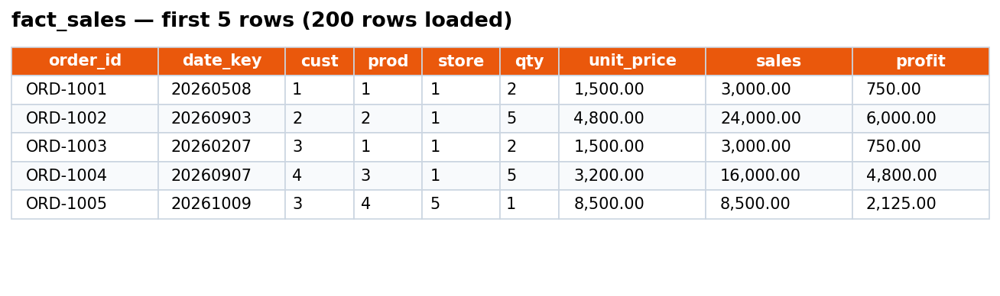
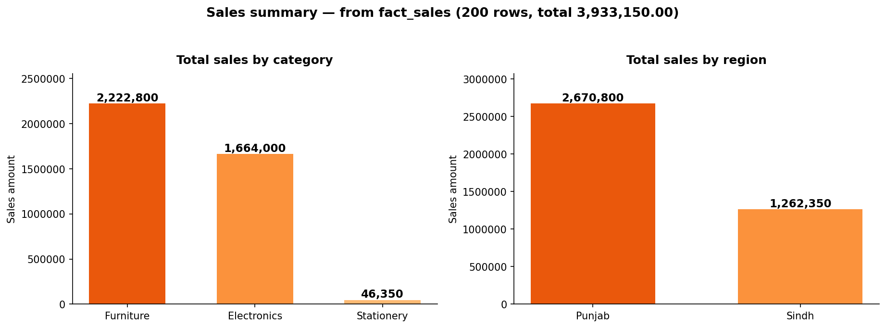
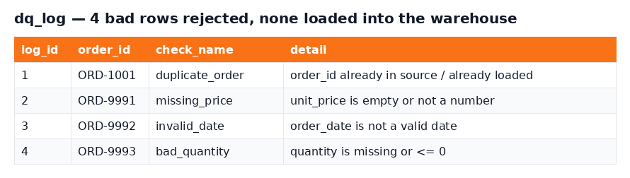

# Retail Sales Data Warehouse & ETL Pipeline

An end-to-end pipeline that takes retail sales data from CSV / Excel / API sources, loads it into a staging area, transforms it, and loads it into a star-schema data warehouse with data marts for reporting in Power BI.

## Demo run


```
204 source rows → 200 clean rows in fact_sales, 4 rejected to the data-quality log
Total sales: 3,933,150.00   Total profit: 1,101,380.00
```

## How it works

```
CSV / Excel / API sources
        ↓
Staging Area (PostgreSQL) — raw data as-is
        ↓
Transform (Python + Pandas) — clean, deduplicate, business rules, data-quality checks
        ↓
Data Warehouse — star schema, SCD Type 2
        ↓
Data Marts — Sales Mart, Product Mart
        ↓
Power BI Dashboard — revenue, region, category KPIs
```

1. **Extract** — the source CSV is read into `staging_sales_raw` exactly as-is, all text, nothing cleaned yet.
2. **Transform** — pandas cleans the data and runs data-quality checks. A row that fails any check is rejected to `dq_log` and never reaches the warehouse.
3. **Load** — dimensions are loaded first (`dim_date`, `dim_customer`, `dim_product`, `dim_store`), then `fact_sales`. Re-running the ETL loads nothing twice: already-loaded `order_id`s are skipped.

## Star schema



One row in `fact_sales` = one order line.

| Table | Columns |
|---|---|
| `dim_date` | date_key, full_date, year, month, day, weekday |
| `dim_customer` | customer_key, customer_id, customer_name, customer_city — SCD Type 2 |
| `dim_product` | product_key, product_id, product_name, category — SCD Type 2 |
| `dim_store` | store_key, store_id, store_name, region |
| `fact_sales` | order_id, date_key, customer_key, product_key, store_key, quantity, unit_price, sales_amount, profit |

**SCD Type 2:** when a tracked customer or product attribute changes, the current row is closed (`effective_to` set, `is_current = 0`) and a new row is opened, so history is kept instead of overwritten.

**Profit:** `sales_amount = quantity × unit_price`, and `profit = sales_amount × category margin` — Electronics 25%, Furniture 30%, Stationery 40%.

## Results

Row counts after a demo run:

| Table | Rows |
|---|---|
| staging_sales_raw | 200 |
| dim_date | 147 |
| dim_customer | 6 |
| dim_product | 6 |
| dim_store | 3 |
| fact_sales | 200 |
| dq_log | 4 |



Sales by category:

| Category | Orders | Total sales | Total profit |
|---|---|---|---|
| Electronics | 114 | 1,664,000.00 | 416,000.00 |
| Furniture | 50 | 2,222,800.00 | 666,840.00 |
| Stationery | 36 | 46,350.00 | 18,540.00 |

Sales by region:

| Region | Orders | Total sales |
|---|---|---|
| Punjab | 134 | 2,670,800.00 |
| Sindh | 66 | 1,262,350.00 |

Top products by sales: Office Chair (2,002,000.00), Mechanical Keyboard (909,500.00), USB-C Hub (576,000.00), LED Desk Lamp (220,800.00), Wireless Mouse (178,500.00), Notebook Pack (46,350.00).



## Data quality

Four checks run on every row. Bad rows are logged in `dq_log`, never loaded:

| Check | What it catches |
|---|---|
| `duplicate_order` | `order_id` already seen in the source or already loaded |
| `missing_price` | `unit_price` is empty or not a number |
| `invalid_date` | `order_date` is not a valid date |
| `bad_quantity` | `quantity` is missing or ≤ 0 |



## Files

| File | What it does |
|---|---|
| `src/generate_sample_data.py` | Creates `data/sample_sales.csv` (204 rows: 200 clean + 4 bad, by design) |
| `sql/schema.sql` | PostgreSQL DDL: `staging` + `warehouse` schemas, star schema, SCD Type 2 columns, DQ log table |
| `src/etl.py` | The ETL: extract → staging load → transform + DQ checks → warehouse load (SCD Type 2) → marts |
| `requirements.txt` | `pandas`, `psycopg2-binary` (PostgreSQL only; the demo mode needs neither) |
| `data/sample_sales.csv` | Sample source data — regenerate any time with the generator |
| `docs/screenshots/` | Screenshots used in this README |

## Run it (demo mode, no PostgreSQL needed)

```bash
cd retail-sales-data-warehouse
python3 src/generate_sample_data.py        # creates data/sample_sales.csv
python3 src/etl.py --demo-sqlite          # full run into warehouse.db (SQLite)
python3 src/etl.py --demo-sqlite --report  # prints row counts + DQ log
```

Demo mode uses SQLite so the whole flow can run without installing PostgreSQL. The logic (staging → transform → SCD Type 2 → fact) is identical; only the connection changes.

## Run it with PostgreSQL

```bash
pip install -r requirements.txt
createdb retail_dw
psql -d retail_dw -f sql/schema.sql
python3 src/etl.py --postgres "postgresql://localhost/retail_dw"
```

Or set `DATABASE_URL=postgresql://localhost/retail_dw` and run `python3 src/etl.py`.
