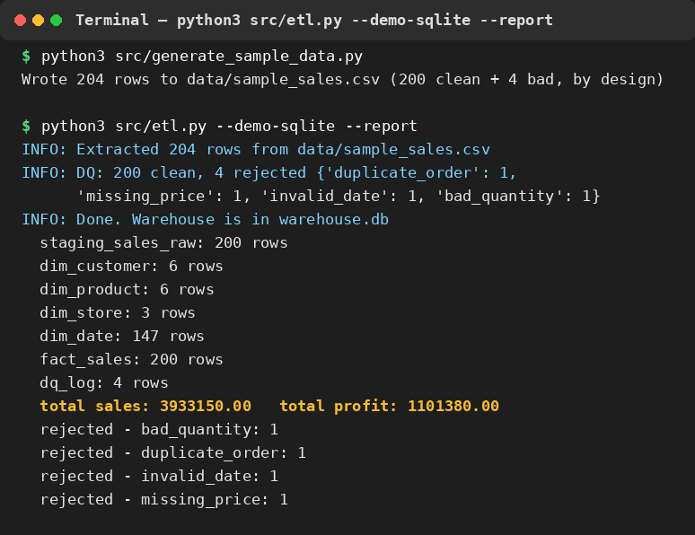
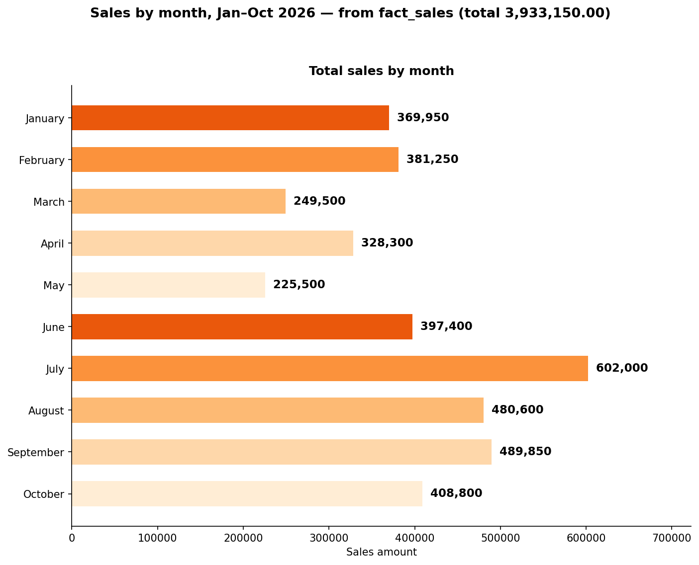

# Retail Sales Data Warehouse & ETL Pipeline

An end-to-end pipeline that takes retail sales data from CSV / Excel / API sources, loads it into a staging area, transforms it, and loads it into a star-schema data warehouse with data marts for reporting in Power BI.

**Status: complete and tested in SQLite demo mode.** What is done: the full pipeline (extract → staging → transform + data-quality checks → star-schema warehouse with SCD Type 2 → data marts), verified end to end on 17 Nov 2026 — see [What was tested](#what-was-tested-17-nov-2026). What is **not** done yet: a live PostgreSQL run, the Talend rebuild, and the Power BI `.pbix` dashboard — see [Remaining work](#remaining-work). Until those are done the project stays marked "(in progress)" on the CV.

## Demo run



```
204 source rows → 200 clean rows in fact_sales, 4 rejected to the data-quality log
Total sales: 3,933,150.00   Total profit: 1,101,380.00
```

## How it works

```
CSV / Excel / API sources
        ↓
Staging Area — raw data as-is (PostgreSQL in production, SQLite in demo mode)
        ↓
Transform (Python + Pandas) — clean, deduplicate, business rules, data-quality checks
        ↓
Data Warehouse — star schema, SCD Type 2
        ↓
Data Marts — Sales Mart, Product Mart
        ↓
Power BI Dashboard — revenue, region, category KPIs
```

1. **Extract** — the source CSV is read into `staging_sales_raw` exactly as-is, all text, nothing cleaned yet. Only rows that pass the data-quality checks are staged; bad rows never reach staging or the warehouse.
2. **Transform** — pandas cleans the data and runs data-quality checks. A row that fails any check is rejected to `dq_log` and never reaches the warehouse.
3. **Load** — dimensions are loaded first (`dim_date`, `dim_customer`, `dim_product`, `dim_store`), then `fact_sales`. Re-running the ETL loads nothing twice: already-loaded `order_id`s are skipped.

## Star schema


One row in `fact_sales` = one order line.

| Table | Columns |
|---|---|
| `dim_date` | date_key, full_date, year, month, month_name, quarter, day_of_week, is_weekend |
| `dim_customer` | customer_key, customer_id, customer_name, city, effective_from, effective_to, is_current — SCD Type 2 |
| `dim_product` | product_key, product_id, product_name, category, effective_from, effective_to, is_current — SCD Type 2 |
| `dim_store` | store_key, store_id, store_name, region |
| `fact_sales` | sale_id, date_key, customer_key, product_key, store_key, quantity, unit_price, sales_amount, profit |

**SCD Type 2:** when a tracked customer or product attribute changes, the current row is closed (`effective_to` set, `is_current = 0`) and a new row is opened, so history is kept instead of overwritten. Verified with a test row — see [What was tested](#what-was-tested-17-nov-2026).

**Profit:** `sales_amount = quantity × unit_price`, and `profit = sales_amount × category margin` — Electronics 25%, Furniture 30%, Stationery 40%.

## Results

Row counts after the fresh demo run on 17 Nov 2026:

| Table | Rows |
|---|---|
| staging_sales_raw | 200 |
| dim_date | 147 |
| dim_customer | 6 |
| dim_product | 6 |
| dim_store | 3 |
| fact_sales | 200 |
| dq_log | 4 |


Sales by category:

| Category | Orders | Total sales | Total profit |
|---|---|---|---|
| Furniture | 50 | 2,222,800.00 | 666,840.00 |
| Electronics | 114 | 1,664,000.00 | 416,000.00 |
| Stationery | 36 | 46,350.00 | 18,540.00 |

Sales by region:

| Region | Orders | Total sales |
|---|---|---|
| Punjab | 134 | 2,670,800.00 |
| Sindh | 66 | 1,262,350.00 |

Top products by sales: Office Chair (2,002,000.00), Mechanical Keyboard (909,500.00), USB-C Hub (576,000.00), LED Desk Lamp (220,800.00), Wireless Mouse (178,500.00), Notebook Pack (46,350.00).


Sales by month (Jan–Oct 2026):

| Month | Orders | Total sales |
|---|---|---|
| January | 18 | 369,950.00 |
| February | 22 | 381,250.00 |
| March | 18 | 249,500.00 |
| April | 17 | 328,300.00 |
| May | 19 | 225,500.00 |
| June | 25 | 397,400.00 |
| July | 18 | 602,000.00 |
| August | 21 | 480,600.00 |
| September | 23 | 489,850.00 |
| October | 19 | 408,800.00 |



## Data quality

Four checks run on every row. Bad rows are logged in `dq_log`, never loaded:

| Check | What it catches |
|---|---|
| `duplicate_order` | `order_id` already seen in the source or already loaded |
| `missing_price` | `unit_price` is empty or not a number |
| `invalid_date` | `order_date` is not a valid date |
| `bad_quantity` | `quantity` is missing or ≤ 0 |


The 4 rejected rows in the demo run: `ORD-1001` (duplicate_order), `ORD-9991` (missing_price), `ORD-9992` (invalid_date), `ORD-9993` (bad_quantity) — one of each, by design.

## Files

| File | What it does |
|---|---|
| `src/generate_sample_data.py` | Creates `data/sample_sales.csv` (204 rows: 200 clean + 4 bad, by design) |
| `sql/schema.sql` | PostgreSQL DDL: `staging` + `warehouse` schemas, star schema, SCD Type 2 columns, DQ log table, data-mart views |
| `src/etl.py` | The ETL: extract → staging load → transform + DQ checks → warehouse load (SCD Type 2) → marts (SQLite demo mode; see PostgreSQL note below) |
| `src/make_screenshots.py` | Regenerates every README screenshot from a fresh pipeline run + the live `warehouse.db` — no hard-coded numbers |
| `requirements.txt` | `pandas` (ETL), `matplotlib` (screenshots only), `psycopg2-binary` (PostgreSQL only, not needed for the demo) |
| `data/sample_sales.csv` | Sample source data — regenerate any time with the generator |
| `docs/screenshots/` | Screenshots used in this README, all regenerated from the 17 Nov 2026 fresh run |

## Run it (demo mode, no PostgreSQL needed)

```bash
cd retail-sales-data-warehouse
python3 src/generate_sample_data.py        # creates data/sample_sales.csv
python3 src/etl.py --demo-sqlite          # full run into warehouse.db (SQLite)
python3 src/etl.py --demo-sqlite --report  # prints row counts + DQ log
python3 src/make_screenshots.py           # re-runs the pipeline fresh and regenerates docs/screenshots/
```

Demo mode uses SQLite so the whole flow can run without installing PostgreSQL. The logic (staging → transform → SCD Type 2 → fact) is identical; only the connection changes.

## Run it with PostgreSQL

The schema is ready and syntax-checked (see below), but the Python PostgreSQL loader is **not implemented yet** — `src/etl.py --postgres` currently exits with a message saying so. Do not expect that command to load data until the loader is written and tested against a live server.

```bash
pip install -r requirements.txt
createdb retail_dw
psql -d retail_dw -f sql/schema.sql   # creates staging + warehouse schemas, tables, mart views
```

Then point the loader at `postgresql://localhost/retail_dw` once the PostgreSQL mode in `src/etl.py` is implemented (see Remaining work).

## What was tested — 17 Nov 2026

Environment: Python 3.12.3, pandas 2.1.4, SQLite demo mode. All numbers in this README are from this run, not from the starter.

- **Fresh run from scratch** (`warehouse.db` deleted, sample data regenerated): 204 source rows → 200 clean, 4 rejected (1 × `duplicate_order`, 1 × `missing_price`, 1 × `invalid_date`, 1 × `bad_quantity`). Row counts: staging 200, dim_date 147, dim_customer 6, dim_product 6, dim_store 3, fact_sales 200, dq_log 4. Total sales 3,933,150.00, total profit 1,101,380.00.
- **Re-run loads nothing twice:** running the ETL again immediately left every count unchanged (fact_sales still 200, totals still 3,933,150.00 / 1,101,380.00).
- **SCD Type 2, verified with a test row:** in a throwaway copy, a new order (`ORD-2001`) was added for an existing customer whose name had changed. The old customer row was closed (`is_current = 0`, `effective_to` set) and a new current row opened; the new fact row points at the new key, the other 5 customers kept exactly one version each, and a further re-run loaded nothing twice (fact stayed 201 in that copy). The delivered `warehouse.db` does **not** contain this test row — it holds the clean 200-row run.
- **Screenshots:** `01`, `03`, `04`, `05` were regenerated from this run by `src/make_screenshots.py` (it re-runs the pipeline fresh and reads every number from the resulting `warehouse.db`); `06` (sales by month) is new, from the same run. `02` is the star-schema diagram — it has no numbers in it, so it was kept as drawn from `sql/schema.sql`.
- **PostgreSQL schema, syntax-checked but NOT run live:** `sql/schema.sql` parses cleanly with the real PostgreSQL parser (`pglast`: 11 statements — 2 schemas, 7 tables, 2 views, no syntax errors), and a SQLite-adapted copy of it executes end to end (all 7 tables + both mart views created; the views return correct joined rows on test data; no foreign-key violations). No PostgreSQL server was available on this machine — no `psql`/`pg_ctl`/`postgres` binaries, no `/usr/lib/postgresql`, and `apt-get update` produced no output in 10+ minutes, so installing a server here was not feasible. **The live PostgreSQL run was NOT tested: the schema has not been applied with `psql`, and `etl.py --postgres` is not implemented.**

## Remaining work

- **Live PostgreSQL run:** install/start PostgreSQL, apply `sql/schema.sql` with `psql`, implement the PostgreSQL loader in `src/etl.py` (same staging → transform → SCD Type 2 → fact logic, via `psycopg2`), and re-run the full pipeline against it, verifying the same 204 → 200 / 4 numbers.
- **Talend rebuild:** rebuild the pipeline in Talend (the original plan for this project).
- **Power BI dashboard:** build the `.pbix` from the data marts (revenue, region, category KPIs) — the marts (`mart_sales`, `mart_product`) are defined in `sql/schema.sql`.
